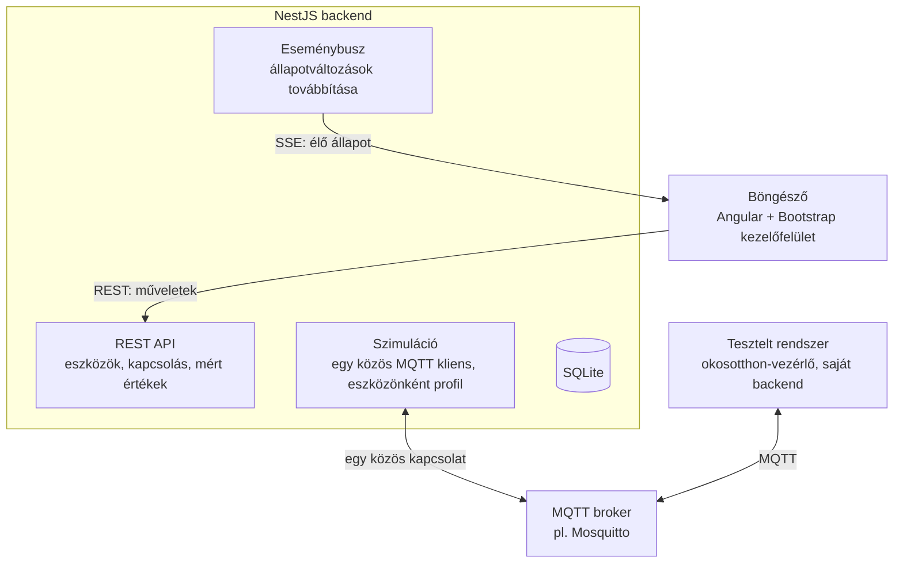

# Technikai specifikáció

A szimulátor egy NestJS backendből és egy Angular frontendből áll; a backend egyetlen közös MQTT-kapcsolaton szolgálja ki az összes szimulált eszközt, a frontend REST-en vezérel és SSE-n kap élő állapotot.

## Architektúra



A felületi művelet REST-en érkezik, a szimulációs réteg a közös MQTT-kapcsolaton az érintett eszköz topicjaira teszi közzé az üzenetet, az állapotváltozás pedig az eseménybuszon át SSE-n jut vissza a böngészőbe. Az MQTT-ről érkező parancsot a topicja alapján kapja meg a megfelelő eszköz, és ugyanezen az úton, REST nélkül frissíti a felületet. A broker felől nézve csak a topicok és az üzenetek számítanak; a közös kapcsolat ára, hogy az eszközöknek nincs saját végakarat-üzenetük (LWT), ezért a nem elérhető állapotot a szimulátor maga teszi közzé.

## Technológiai stack és projektszerkezet

A két alkalmazás egy tárolóban (monorepo) él, npm workspace-ekkel; éles futáskor a NestJS szolgálja ki az Angular build statikus fájljait is, így egyetlen folyamat és egyetlen port kell.

| Réteg | Választás | Indok |
| --- | --- | --- |
| Futtatókörnyezet | Node.js aktuális LTS, TypeScript (strict) | Közös nyelv és közös típusok a két oldalon |
| Backend keret | NestJS (Express adapter) | Modulok, DI, validáció, Swagger készen |
| MQTT kliens | `mqtt` (MQTT.js) | Egy közös kliens az összes eszköznek, újracsatlakozás beépítve |
| Validáció | `class-validator`, `class-transformer` | DTO-szintű ellenőrzés a REST határon |
| API-leírás | `@nestjs/swagger`, `/api/docs` | A frontend típusai ebből generálhatók |
| Perzisztencia | SQLite (`better-sqlite3`) TypeORM-mel (`@nestjs/typeorm`) | Egyetlen helyi fájl, külön adatbázisszerver nélkül; tranzakciós írás, sémamigrációk |
| Élő frissítés | Server-Sent Events (`@Sse`) | Egyirányú csatorna elég, a böngésző magától újracsatlakozik |
| Frontend | Angular (standalone komponensek, signals), Bootstrap 5, Bootstrap Icons | A kérés szerint; komponenskönyvtár nélkül, tiszta Bootstrap CSS |
| Tesztek | Jest (backend), Aedes memóriában futó broker az integrációs tesztekhez | Valódi MQTT-forgalom külső függőség nélkül |
| Csomagolás | Docker, `docker compose` Mosquitto brokerrel | Egy paranccsal indul (N-04) |

```text
iot-szimulator/
  package.json              # workspaces: backend, frontend, shared
  Dockerfile                # többlépcsős build
  docker-compose.yml        # szimulátor + Mosquitto
  docker/mosquitto/         # mosquitto.conf
  config/                   # devices.json minta (CONFIG_FILE)
  shared/                   # közös TypeScript típusok (Device, DTO-k, események)
  backend/src/
    main.ts
    app.module.ts
    config/                 # környezeti változók
    storage/                # SQLite: entitások, migrációk
    broker/                 # brokerbeállítás, kapcsolatteszt
    devices/                # REST kontroller, szolgáltatás, DTO-k
    simulation/             # eszközpéldányok, közös MQTT kliens, topic-útválasztás, időzítők
      profiles/shelly/      # Shelly Gen2+ protokoll (Gen2, Gen3, Gen4)
      profiles/tasmota/     # Tasmota protokoll
    events/                 # SSE
  frontend/src/app/
    core/                   # API kliens, eseményfolyam, modellek
    devices/                # lista, részletek, űrlap
    settings/               # broker beállítás
    shared/                 # kapcsoló-, mérő-, hőmérő-komponens
```

## Adatmodell és perzisztencia

Egy eszköz konfigurációból (mit szimulálunk) és állapotból (mit mutat éppen) áll; mindkettő a `shared` csomagban definiált típus, és az SQLite adatbázisban tárolódik.

```ts
type DeviceType = 'shelly-1pm' | 'shelly-2pm' | 'tasmota';
type ShellyGeneration = 2 | 3 | 4;

interface Device {
  id: string;                 // belső UUID
  name: string;               // megjelenített név
  type: DeviceType;
  enabled: boolean;           // false = lekapcsolva (F-14)
  shelly?: ShellyConfig;
  tasmota?: TasmotaConfig;
  switches: SwitchState[];    // 1PM: 1, 2PM: 2, Tasmota: relayCount
  sensors: TemperatureState[]; // Shelly Add-on, ill. Tasmota DS18B20
}

interface ShellyConfig {
  generation: ShellyGeneration; // az azonosítót, a modellkódot és a gen mezőt határozza meg
  deviceId: string;           // pl. shellyplus1pm-a8032abe54dc, shelly1pmg3-a8032abe54dc
  topicPrefix: string | null; // null = deviceId
  rpcNtf: boolean;            // events/rpc értesítések
  statusNtf: boolean;         // status/<komponens> üzenetek
  enableControl: boolean;     // command/<komponens> vezérlés
  addon: { enabled: boolean; sensorCount: number }; // 0..5
}

interface TasmotaConfig {
  mac: string;                // 12 hex, nagybetűs; a discovery topicjához
  topic: string;              // pl. tasmota_BE54DC
  fullTopic: string;          // alap: %prefix%/%topic%/
  groupTopic: string;         // alap: tasmotas
  relayCount: number;         // 1..8
  hasEnergy: boolean;
  sensorCount: number;        // DS18B20 hőmérők száma, 0..8
  discovery: boolean;         // Tasmota discovery üzenetek, alap: false
  telePeriod: number;         // mp, alap: 300, 10..3600
  publishOnChange: boolean;   // mért érték változásakor azonnali SENSOR
  powerRetain: boolean;       // alap: false
}

interface SwitchState {
  index: number;              // 0-tól
  output: boolean;
  source: string;             // Shelly: init | MQTT | button ...
  meter?: MeterState;         // Shelly: kapcsolónként; Tasmota: csak a 0. kapcsolón
}

interface MeterState {
  loadPower: number;          // W, a felhasználó által megadott terhelés
  voltage: number;            // V, alap: 230
  currentOverride: number | null; // A; null = számolt
  powerFactor: number;        // 0..1, alap: 1
  frequency: number;          // Hz, alap: 50
  energyTotalWh: number;      // halmozott számláló
  energyTodayWh: number;      // Tasmota Today
  energyYesterdayWh: number;  // Tasmota Yesterday
  energyUpdatedAt: string;    // ISO idő, az utolsó integrálás ideje
}

interface TemperatureState {
  index: number;              // 0-tól; Shelly: komponensazonosító = 100 + index
  address: string;            // DS18B20 cím, felvételkor generált (Tasmota Id mező)
  tC: number | null;
  error: 'read' | 'out_of_range' | null;
}
```

**Tárolás.** Az adatbázis egyetlen fájl (`DATA_DIR/simulator.sqlite`, WAL módban), a sémát TypeORM-migrációk hozzák létre induláskor. A futó állapot a memóriában él; kapcsolás, mért érték és konfiguráció változása azonnal, tranzakcióban íródik ki, a folyamatosan növekvő energiaszámlálók 10 másodpercenként és leálláskor (`SIGTERM`). Az üzenetnapló csak a memóriában van.

| Tábla | Oszlopok |
| --- | --- |
| `settings` | `key`, `value` (JSON): brokerbeállítás |
| `devices` | `id`, `name`, `type`, `enabled`, `config` (JSON: `ShellyConfig` vagy `TasmotaConfig`), `created_at`, `updated_at` |
| `switches` | `device_id`, `idx`, `output`, `source`, valamint a `MeterState` mezői (mérő nélkül NULL) |
| `temperature_sensors` | `device_id`, `idx`, `address`, `tc`, `error` |

A `switches` és a `temperature_sensors` sorai az eszközzel együtt törlődnek (`ON DELETE CASCADE`).

**Egyediség.** A Shelly `deviceId` és a tényleges topic-előtag, illetve a Tasmota `topic` egyedi az eszközök között; ütközéskor az API 409-et ad.

## Shelly MQTT-viselkedés

A Shelly profil a Gen2+ eszközök három MQTT-csatornáját valósítja meg: RPC, állapotértesítések és egyszerű szöveges vezérlés. Az alábbiakban `<p>` a topic-előtag (alapból az eszközazonosító), `<id>` az eszközazonosító. A topicok forrása a hivatalos [MQTT](https://shelly-api-docs.shelly.cloud/gen2/ComponentsAndServices/Mqtt/), [Switch](https://shelly-api-docs.shelly.cloud/gen2/ComponentsAndServices/Switch) és [Temperature](https://shelly-api-docs.shelly.cloud/gen2/ComponentsAndServices/Temperature) dokumentáció.

### Kapcsolódás

- A közös kapcsolaton az eszköznek nincs saját kliensazonosítója és végakarata; az elérhetőséget a szimulátor teszi közzé az eszköz topicján.
- Eszköz indításakor (felvétel, visszakapcsolás, újracsatlakozás a brokerhez): `<p>/online` = `true`, majd minden komponens teljes állapota a `<p>/status/<komponens>` topicra (ha `statusNtf` be van kapcsolva).
- Eszköz leállításakor (lekapcsolás, törlés, a szimulátor szabályos leállása): `<p>/online` = `false`.
- Az `online` üzenet megőrzött (retain) jelzője beállítás, alapból bekapcsolva; a dokumentáció erről nem nyilatkozik, valós eszközön ellenőrizendő.

### Feliratkozások (bejövő)

| Topic | Tartalom | Viselkedés |
| --- | --- | --- |
| `<id>/rpc` és `<p>/rpc` | JSON RPC kérés | Válasz a `<src>/rpc` topicra; `src` nélkül nincs válasz |
| `<p>/command` | `status_update` | Teljes eszközállapot a `<p>/status` topicra, és komponensenként a `<p>/status/<komponens>` topicokra |
| `<p>/command` | `announce` | `Shelly.GetDeviceInfo` eredménye a `<p>/announce` és a `shellies/announce` topicra |
| `shellies/command` | mint fent | Közös topic minden Shelly eszköznek |
| `<p>/command/switch:<n>` | `on`, `off`, `toggle`, `on,<mp>`, `off,<mp>`, `status_update` | Kapcsolás, ill. állapot a `<p>/status/switch:<n>` topicra; ismeretlen parancsra hiba a `<p>/error/switch:<n>` topicra |

A `command` topicok csak akkor élnek, ha az `enableControl` be van kapcsolva.

### Közzétett üzenetek (kimenő)

| Topic | Mikor | Tartalom |
| --- | --- | --- |
| `<p>/online` | Eszköz indításakor, ill. leállításakor | `true` / `false` |
| `<p>/events/rpc` | Komponensállapot változásakor, ha `rpcNtf` aktív | `NotifyStatus`, csak a megváltozott mezőkkel |
| `<p>/status/switch:<n>` | Kapcsoláskor, mért érték változásakor, percenként, ha `statusNtf` aktív | A komponens teljes állapota |
| `<p>/status/temperature:<id>` | Hőmérséklet változásakor, ha `statusNtf` aktív | `{"id":100,"tC":22.5,"tF":72.5}` |
| `<src>/rpc` | RPC kérésre | Válasz vagy hiba |

### Kapcsoló állapota

```json
{
  "id": 0,
  "source": "MQTT",
  "output": true,
  "apower": 1200.0,
  "voltage": 230.0,
  "current": 5.217,
  "pf": 1.0,
  "freq": 50.0,
  "aenergy": { "total": 15234.512, "by_minute": [20000.0, 20000.0, 19850.3], "minute_ts": 1794648840 },
  "temperature": { "tC": 45.0, "tF": 113.0 }
}
```

Az `aenergy.total` Wh, a `by_minute` az utolsó három teljes perc energiája mWh-ban, a `minute_ts` az aktuális perc kezdete (Unix idő). A `temperature` itt az eszköz belső hőmérséklete: rögzített 45 °C, nem állítható. A `source` értéke MQTT-parancsnál `MQTT`, felületi kapcsolásnál `button`, indítás után `init`.

### Értesítés az `events/rpc` topicon

```json
{
  "src": "shellyplus1pm-a8032abe54dc",
  "dst": "shellyplus1pm-a8032abe54dc/events",
  "method": "NotifyStatus",
  "params": { "ts": 1794648851.42, "switch:0": { "id": 0, "output": true, "source": "MQTT" } }
}
```

Ez a szerkezet a Shelly értesítési keretét követi; a fenti forrásoldalak nem közölnek rá példát, ezért az első mérföldkőnél valós eszköz forgalmával összevetendő.

**Küldési szabályok.** Kapcsoláskor: `output` és `source`, majd a megváltozott `apower` és `current`. Terhelés vagy feszültség átírásakor: a megváltozott mért mezők. Minden egész percben: `aenergy`. Hőmérő átírásakor: `temperature:<id>` a `tC`, `tF` mezőkkel. A valós eszköz a hőmérsékletet csak 0,5 °C-nál nagyobb változásra jelenti; a szimulátor minden kézi átírást elküld, mert az teszteléshez hasznosabb.

### Támogatott RPC metódusok

| Metódus | Paraméterek | Eredmény |
| --- | --- | --- |
| `Switch.Set` | `id`, `on`, `toggle_after` (opcionális, mp) | `{"was_on": <bool>}` |
| `Switch.Toggle` | `id` | `{"was_on": <bool>}` |
| `Switch.GetStatus` | `id` | A kapcsoló teljes állapota |
| `Switch.GetConfig` | `id` | Minimális konfiguráció: `id`, `name`, `initial_state` |
| `Switch.ResetCounters` | `id` | A nullázás előtti `aenergy.total` |
| `Temperature.GetStatus` | `id` (100–104) | `{"id", "tC", "tF"}` |
| `Shelly.GetStatus` | – | Minden komponens állapota komponenskulccsal (`switch:0`, `temperature:100`, …) |
| `Shelly.GetDeviceInfo` | – | `id`, `mac`, `model`, `gen`, `fw_id`, `ver`, `app` |

Kérés és válasz:

```json
// -> shellyplus1pm-a8032abe54dc/rpc
{ "id": 7, "src": "teszt", "method": "Switch.Set", "params": { "id": 0, "on": true } }

// <- teszt/rpc
{ "id": 7, "src": "shellyplus1pm-a8032abe54dc", "dst": "teszt", "result": { "was_on": false } }
```

Ismeretlen metódusra `error: { "code": 404, "message": "No handler for <metódus>" }`, hibás paraméterre `code: -103` megy vissza; hibás JSON-ra nincs válasz. A hibakódok valós eszközzel ellenőrizendők.

### Visszakapcsolási időzítő (`toggle_after`)

A kimenet egy kapcsolással együtt időzítővel is állítható: a megadott idő után az eszköz magától az ellenkező állapotba vált vissza.

| Indítás | Példa | Jelentés |
| --- | --- | --- |
| RPC | `Switch.Set` `{"id": 0, "on": true, "toggle_after": 30}` | Bekapcsol, 30 mp múlva kikapcsol; a válasz `{"was_on": …}` |
| Parancstopic | `<p>/command/switch:0` = `on,30`, ill. `off,30` | Ugyanez a parancstopicon; az idő tizedes tört is lehet |

Futó időzítő alatt a kapcsoló állapotában (`status/switch:<n>`, `Switch.GetStatus`, `Shelly.GetStatus`, valamint a változáskor küldött `NotifyStatus`) három mező is szerepel; lejárat vagy megszakítás után eltűnnek:

```json
{ "id": 0, "output": true, "source": "MQTT", "timer_started_at": 1794652540.26, "timer_duration": 30, "timer_type": "toggle_after" }
```

| Viselkedés | A szimulátorban | Forrás |
| --- | --- | --- |
| Az időtartam | Másodperc, pozitív szám; érvénytelen értékre `-103` hiba (`Invalid argument 'toggle_after'!`), a kimenet nem változik | Dokumentált: „flip-back timer in seconds” |
| Állapotmezők | `timer_started_at` (Unix-idő, UTC), `timer_duration` (mp) és `timer_type` = `toggle_after`, csak futó időzítőnél | Dokumentált |
| Parancstopic | `on[,<mp>]`, `off[,<mp>]`; hibás szám a `<p>/error/switch:<n>` topicra megy | Dokumentált (a hibatopic a meglévő hibakezelést követi) |
| Megszakítás | Bármely más kapcsolás (felület, MQTT, időzítő nélküli `Switch.Set` vagy `Switch.Toggle`) megszakítja; új időzítős parancs a régi helyére lép, akkor is, ha a kimenet már a kért állapotban van | Feltételezés: a dokumentáció nem írja le; a Shelly általános elve, hogy a relé mindig az utolsó parancsot követi, és a `power_restore_delay` időzítőt is minden explicit parancs megszakítja |
| A lejárat forrása | `source: "timer"` | Feltételezés: a dokumentáció nem nevez meg értéket; valós eszközön ellenőrizendő |
| Pontosság | A közös másodperces óra váltja vissza, ezért legfeljebb kb. 1 mp késhet | A szimulátor sajátossága |
| Újraindulás | Az eszköz újraindulásakor (lekapcsolás, a feliratkozásokat érintő módosítás, a szimulátor újraindítása) a futó időzítő elvész | A valós eszköz újraindulásához hasonló; ellenőrizendő |

### Azonosítók

| Típus | Generáció | Eszközazonosító | `model` | `gen` | Komponensek |
| --- | --- | --- | --- | --- | --- |
| 1PM | Gen2 (Plus) | `shellyplus1pm-<mac>` | `SNSW-001P16EU` | 2 | `switch:0` |
| 1PM | Gen3 | `shelly1pmg3-<mac>` | `S3SW-001P16EU` | 3 | `switch:0` |
| 1PM | Gen4 | `shelly1pmg4-<mac>` | `S4SW-001P16EU` | 4 | `switch:0` |
| 2PM | Gen2 (Plus) | `shellyplus2pm-<mac>` | `SNSW-102P16EU` | 2 | `switch:0`, `switch:1` |
| 2PM | Gen3 | `shelly2pmg3-<mac>` | `S3SW-002P16EU` | 3 | `switch:0`, `switch:1` |
| 2PM | Gen4 | `shelly2pmg4-<mac>` | `S4SW-002P16EU` | 4 | `switch:0`, `switch:1` |

A `<mac>` 12 kisbetűs hexadecimális jegy. Az Add-on bármelyik soron bekapcsolható, és a `temperature:100` … `temperature:104` komponenseket adja hozzá. A három generációt egyetlen Shelly-profil szolgálja ki: a topicok, az RPC és az üzenetek azonosak, a generáció csak ezt a táblázatot és a `Shelly.GetDeviceInfo` válaszát paraméterezi.

Az 1PM Gen3 ([adatlap](https://media.hornbach.de/hb/datasheet/as.186822963.pdf)) és a 2PM Gen4 ([termékoldal](https://asia.shelly.com/products/shelly-2pm-gen4)) azonosítója és modellkódja gyártói forrásból származik. A 2PM Gen3 és az 1PM Gen4 sora, valamint a Plus modellkódok a névmintából következtetettek, ellenőrizendők.

## Tasmota MQTT-viselkedés

A Tasmota profil a három előtagos topicrendszert követi: `cmnd` a parancsoknak, `stat` a válaszoknak, `tele` az időszakos telemetriának. Az alapértelmezett teljes topic `%prefix%/%topic%/`; az alábbiakban `<t>` az eszköz topicja. Forrás: [Tasmota MQTT dokumentáció](https://tasmota.github.io/docs/MQTT).

### Kapcsolódás

- Eszköz indításakor: `tele/<t>/LWT` = `Online` (megőrzött), relénként a kapcsolóállapot (`stat/<t>/RESULT` és `stat/<t>/POWER<x>`), majd egy `tele/<t>/STATE` és, ha van fogyasztásmérő vagy hőmérő, egy `tele/<t>/SENSOR`.
- Eszköz leállításakor: `tele/<t>/LWT` = `Offline` (megőrzött); ezt a szimulátor küldi, nem a broker.
- Feliratkozás a közös kapcsolaton: `cmnd/<t>/#` és `cmnd/<groupTopic>/#` (alapból `tasmotas`).

### Parancsok

A parancsnév és a tartalom nem érzékeny a kis- és nagybetűre. Üres tartalom vagy `?` lekérdezést jelent.

| Parancs (`cmnd/<t>/…`) | Tartalom | Válasz |
| --- | --- | --- |
| `POWER`, `POWER<x>` | `ON` vagy `1`, `OFF` vagy `0`, `TOGGLE` vagy `2`, üres | `stat/<t>/RESULT` = `{"POWER":"ON"}` és `stat/<t>/POWER` = `ON` |
| `STATUS` | `8` vagy `10` | `stat/<t>/STATUS8`, ill. `STATUS10` = `{"StatusSNS":{…}}` a `SENSOR` tartalmával |
| `STATUS` | `11` | `stat/<t>/STATUS11` = `{"StatusSTS":{…}}` a `STATE` tartalmával |
| `TELEPERIOD` | szám (mp) vagy üres | `stat/<t>/RESULT` = `{"TelePeriod":300}`; az új érték elmentődik |
| bármi más | – | `stat/<t>/RESULT` = `{"Command":"Unknown"}` |

Egy relénél a kulcs `POWER` (a `POWER1` parancs is ezt kapcsolja), több relénél `POWER1` … `POWERn`. Ha a `powerRetain` aktív, a `stat/<t>/POWER<x>` üzenet megőrzött. A `STATUS` válaszok és a csatlakozáskori üzenetsor pontos alakja valós eszközzel ellenőrizendő, mert a fenti forrásoldal ezeket nem részletezi.

### Telemetria

A `tele/<t>/STATE` és a `tele/<t>/SENSOR` `telePeriod` másodpercenként megy ki (alap: 300). Ha a `publishOnChange` aktív, mért érték átírásakor és kapcsoláskor azonnal is kimegy egy `SENSOR`.

```json
// tele/tasmota_BE54DC/STATE
{ "Time": "2026-11-14T10:35:00", "Uptime": "0T00:10:09", "UptimeSec": 609, "POWER": "ON" }

// tele/tasmota_BE54DC/SENSOR
{
  "Time": "2026-11-14T10:35:00",
  "ENERGY": {
    "TotalStartTime": "2026-11-01T00:00:00",
    "Total": 15.235, "Yesterday": 1.204, "Today": 0.375, "Period": 100,
    "Power": 1200, "ApparentPower": 1200, "ReactivePower": 0, "Factor": 1.00,
    "Voltage": 230, "Current": 5.217
  }
}
```

A `Total`, `Yesterday` és `Today` kWh, a `Period` az előző telemetria óta fogyasztott energia Wh-ban. Az időbélyeg a szerver helyi ideje, időzóna-jelölés nélkül. Helyi idő szerinti éjfélkor a `Today` értéke átkerül a `Yesterday` mezőbe, és nullázódik.

### DS18B20 hőmérők

A hőmérők a `SENSOR` telemetriában jelennek meg, ugyanabban az üzenetben, mint az `ENERGY` blokk. Egy hőmérőnél a kulcs `DS18B20`, többnél `DS18B20-1` … `DS18B20-n`.

```json
// tele/tasmota_BE54DC/SENSOR, két hőmérővel, fogyasztásmérő nélkül
{
  "Time": "2026-11-14T10:35:00",
  "DS18B20-1": { "Id": "3C01F0956A2B", "Temperature": 21.5 },
  "DS18B20-2": { "Id": "3C01F0957C10", "Temperature": 48.2 },
  "TempUnit": "C"
}
```

Az érték 1 tizedesre kerekített °C. Szenzorhiba szimulációjakor az adott hőmérő kulcsa kimarad az üzenetből. A hőmérséklet átírása a `publishOnChange` beállítás mellett azonnali `SENSOR` üzenetet vált ki; a `STATUS 10` válasza ugyanezt a tartalmat adja a `StatusSNS` kulcs alatt. A kulcsok és az `Id` formátuma valós eszközzel ellenőrizendő.

### Tasmota discovery

Ha az eszközön a `discovery` be van kapcsolva, indításkor két megőrzött üzenet megy ki, amelyekből a Home Assistant Tasmota integrációja kézi beállítás nélkül felveszi az eszközt. A topicok és a mezők egy [valós eszköz naplózott üzenetét](https://community.home-assistant.io/t/tasmota-mqtt-disovery-issues/242713) követik.

| Topic | Tartalom |
| --- | --- |
| `tasmota/discovery/<MAC>/config` | Az eszköz leírása: topicok, relék, elérhetőségi értékek |
| `tasmota/discovery/<MAC>/sensors` | `{"sn": { …a SENSOR üzenet tartalma… }, "ver": 1}` |

```json
// tasmota/discovery/A8032ABE54DC/config (megőrzött)
{
  "ip": "192.0.2.220", "dn": "Bojler", "fn": ["Bojler", null, null, null, null, null, null, null],
  "hn": "tasmota-BE54DC-5340", "mac": "A8032ABE54DC", "md": "Generic", "ty": 0, "if": 0,
  "ofln": "Offline", "onln": "Online", "state": ["OFF", "ON", "TOGGLE", "HOLD"],
  "sw": "14.4.1", "t": "tasmota_BE54DC", "ft": "%prefix%/%topic%/", "tp": ["cmnd", "stat", "tele"],
  "rl": [1, 0, 0, 0, 0, 0, 0, 0], "swc": [-1, -1, -1, -1, -1, -1, -1, -1],
  "swn": [null, null, null, null, null, null, null, null], "btn": [0, 0, 0, 0, 0, 0, 0, 0],
  "so": { "4": 0, "11": 0, "13": 0, "17": 0, "20": 0, "30": 0, "68": 0, "73": 0, "82": 0, "114": 0, "117": 0 },
  "lk": 0, "lt_st": 0, "sho": [0, 0, 0, 0],
  "sht": [[0, 0, 0], [0, 0, 0], [0, 0, 0], [0, 0, 0]], "ver": 1
}
```

- **Kitöltés.** `dn` az eszköz neve, `fn` relénként a név (a második relétől „név 2”, „név 3” …), a többi `null`; `t`, `ft`, `tp` a topicbeállítás, `rl` első `relayCount` eleme 1 (relé), a többi 0. A `hn` a Tasmota alapértelmezett hosztneve (`tasmota-<MAC utolsó 6 jegye>-<a MAC utolsó két bájtja & 0x1FFF>`), az `ip` a 192.0.2.0/24 dokumentációs tartományból a MAC utolsó bájtja szerint; az `md` és a `sw` rögzített.
- **Mikor megy ki.** Eszköz indításakor (a `LWT` után), a discovery bekapcsolásakor és átnevezéskor; topic, relészám, mérő vagy szenzorszám változásakor az eszköz újraindul, és az indulás küldi ki az új szerkezetet. A beállítás lekapcsolt eszközön is frissíthető, mert a közös kapcsolat él.
- **Törlés.** A `discovery` kikapcsolásakor és az eszköz törlésekor mindkét topicra üres, megőrzött üzenet megy ki, ami eltávolítja az eszközt a vezérlőből. Lekapcsoláskor (F-14) a felfedezési üzenet megmarad, csak az `LWT` vált `Offline` értékre.
- **Feltétel.** A `fullTopic` tartalmazza a `%prefix%` és a `%topic%` jelölőt is; enélkül az API nem engedi bekapcsolni a discoveryt.

A mezőlista a Tasmota-verzióval bővül; a megvalósításkor az aktuális Home Assistant Tasmota integrációval kell kipróbálni, hogy a fenti mezők elégségesek-e.

## Mérési modell

A felhasználó a terhelést adja meg, a jelentett értékeket a szimulátor ebből és a kapcsoló állapotából számolja; a két protokoll ugyanazt a számolást használja, csak a mértékegység és a kerekítés tér el.

```latex
P = \begin{cases} P_{terhelés} & \text{ha a kapcsoló be van kapcsolva} \\ 0 & \text{különben} \end{cases}
\qquad I = \frac{P}{U \cdot \cos\varphi}
\qquad S = U \cdot I
\qquad Q = \sqrt{S^2 - P^2}
```

- **Áramerősség.** Ha a felhasználó kézzel megadta (`currentOverride`), az érvényes, de kikapcsolt állapotban ekkor is 0.
- **Energiaszámláló.** Az integrálás eseményvezérelt, nincs másodpercenkénti időzítő: minden olyan pillanatban, amikor P megváltozhat (kapcsolás, terhelés átírása) vagy értéket kell közölni (percváltás, telemetria, lekérdezés), a számláló az előző P értékkel és az eltelt idővel nő: ΔE \[Wh\] = P × Δt \[s\] / 3600.
- **Kiesés.** A lekapcsolt eszköz tovább mér, ahogy a valós eszköz hálózati hiba alatt. A szimulátor leállítása alatt a számláló áll; indításkor az `energyUpdatedAt` az aktuális időre áll.
- **Shelly percenkénti bontás.** Az utolsó három teljes perc energiája külön tárolódik mWh-ban a `by_minute` mezőhöz.
- **Tasmota több relével.** Egyetlen `ENERGY` blokk van; a jelentett teljesítmény akkor nem nulla, ha legalább egy relé be van kapcsolva.

| Mező | Shelly | Tasmota |
| --- | --- | --- |
| Teljesítmény | `apower`, W, 1 tizedes | `Power`, W, egész |
| Feszültség | `voltage`, V, 1 tizedes | `Voltage`, V, egész |
| Áramerősség | `current`, A, 3 tizedes | `Current`, A, 3 tizedes |
| Teljesítménytényező | `pf`, 2 tizedes | `Factor`, 2 tizedes |
| Halmozott energia | `aenergy.total`, Wh, 3 tizedes | `Total`, kWh, 3 tizedes |

## REST API és élő eseménycsatorna

Minden végpont az `/api` előtag alatt van, JSON-t fogad és ad vissza; a módosító hívások a teljes, friss `Device` objektummal válaszolnak. A géppel olvasható leírás az `/api/docs` címen érhető el (Swagger).

| Metódus | Útvonal | Törzs | Leírás |
| --- | --- | --- | --- |
| GET | `/api/broker` | – | Brokerbeállítás jelszó nélkül, és a kapcsolati állapot |
| PUT | `/api/broker` | `{ host, port, username?, password?, tls }` | Mentés; a közös kapcsolat újraépül, az eszközök újra közzéteszik az állapotukat |
| POST | `/api/broker/test` | mint fent | Próbakapcsolat mentés nélkül; `{ ok, error? }` |
| GET | `/api/devices` | – | Eszközök listája állapottal |
| POST | `/api/devices` | `CreateDeviceDto` | Új eszköz; 409, ha az azonosító vagy a topic foglalt |
| GET | `/api/devices/:id` | – | Egy eszköz |
| PATCH | `/api/devices/:id` | `UpdateDeviceDto` | Név és konfiguráció; topicváltáskor újrafeliratkozás |
| DELETE | `/api/devices/:id` | – | Nem elérhető üzenet, leiratkozás, majd törlés |
| POST | `/api/devices/:id/connect` | – | Eszköz visszakapcsolása: elérhető üzenet és kezdő állapot |
| POST | `/api/devices/:id/disconnect` | – | Eszköz lekapcsolása: kimegy a nem elérhető üzenet, utána az eszköz nem küld és nem fogad |
| PUT | `/api/devices/:id/switches/:index` | `{ output: boolean }` | Kapcsolás |
| POST | `/api/devices/:id/switches/:index/toggle` | – | Átváltás |
| PUT | `/api/devices/:id/switches/:index/meter` | `{ loadPower?, voltage?, currentOverride?, powerFactor?, frequency?, energyTotalWh? }` | Mért értékek; csak a megadott mezők változnak |
| POST | `/api/devices/:id/switches/:index/meter/reset` | – | Energiaszámláló nullázása |
| PUT | `/api/devices/:id/sensors/:index` | `{ tC: number or null, error? }` | Hőmérő értéke |
| GET | `/api/devices/:id/messages` | – | Az utolsó 200 MQTT-üzenet |
| GET | `/api/events` | – | SSE eseményfolyam |
| GET | `/api/homeassistant/config` | – | Home Assistant MQTT-konfiguráció és a hozzá tartozó compose: `{ yaml, compose, deviceCount, entityCount, warnings }`; szűrés: `?ids=a,b`, `?includeDiscovered=true` |
| GET | `/api/homeassistant/config.yaml` | – | Ugyanaz a YAML letölthető fájlként (`iot_simulator.yaml`, `text/yaml`, `Content-Disposition: attachment`) |
| GET | `/api/homeassistant/docker-compose.yml` | – | Compose-fájl letöltésre az alapbeállításokkal (Mosquitto jelszó nélkül, Node-RED nélkül); nem függ a kiválasztástól |
| POST | `/api/homeassistant/compose` | `ComposeOptions` | A compose a megadott beállításokkal: `{ compose, warnings }`; hibás beállításra 400 mezőszintű hibalistával |
| POST | `/api/homeassistant/docker-compose.yml` | `ComposeOptions` | Ugyanez letölthető fájlként (`Content-Disposition: attachment`) |

Konfiguráció és üzemeltetés:

| Metódus | Útvonal | Törzs | Leírás |
| --- | --- | --- | --- |
| GET | `/api/config/export?includeState=true` | – | A teljes konfiguráció letölthető JSON fájlként (`iot-simulator-config-<dátum>.json`, `Content-Disposition: attachment`); alapból állapottal, `includeState=false` esetén nélküle |
| POST | `/api/config/import?mode=merge` | a JSON konfiguráció | Import `merge` (alapérték), `replace` vagy `seed` módban; válasz: `{ mode, applied, skipped, created, updated, unchanged, removed, broker }`, az eszközök nevével, típusával és azonosítójával; hibás fájlra 400: `{ message, errors: [{ path, device, message }] }` |
| POST | `/api/config/import?mode=merge&dryRun=true` | mint fent | Csak ellenőrzés és összesítés, írás nélkül; a felület ezzel mutat előnézetet |
| GET | `/api/health` | – | `{ status, mqtt }`; a Docker egészség-ellenőrzése hívja |

A `GET /api/broker` válaszában a `managedByEnv` mező jelzi, ha a beállítás környezeti változóból jön; ilyenkor a `PUT /api/broker` 409-et ad.

**Validáció.** `loadPower` 0–10 000 W, `voltage` 0–300 V, `powerFactor` 0–1, `frequency` 45–65 Hz, `tC` −55…125, `relayCount` 1–8, `sensorCount` 0–5 (Shelly Add-on), ill. 0–8 (Tasmota), `telePeriod` 10–3600. A topicokban tilos a `#`, `+` és a szóköz. Hibás törzsre 400 megy vissza mezőszintű hibalistával, ismeretlen eszközre 404.

**SSE események.** A frontend induláskor egyszer lekéri a listát, utána az eseményekből frissít.

| Esemény | Adat | Mikor |
| --- | --- | --- |
| `device.updated` | teljes `Device` | Bármely állapot- vagy konfigurációváltozás, MQTT-ről érkezett kapcsolás is |
| `device.removed` | `{ id }` | Törlés |
| `device.connection` | `{ id, status, error? }` | `connecting`, `online`, `offline`, `error` |
| `broker.status` | `{ reachable, error? }` | A broker elérhetőségének változása |
| `mqtt.message` | `{ deviceId, ts, direction, topic, payload, retain }` | Minden küldött és fogadott üzenet |

A percenkénti energiafrissítés nem küld `device.updated` eseményt minden eszközre egyszerre: a frontend a számlálót a teljesítményből maga lépteti két esemény között.

## Backend modulok és frontend felépítés

A protokollismeret a profilokban van, minden más réteg protokollfüggetlen: új eszköztípushoz egy új profilt kell írni és regisztrálni (N-05).

### Backend

| Modul | Felelősség |
| --- | --- |
| `ConfigModule` | Környezeti változók beolvasása és ellenőrzése |
| `StorageModule` | SQLite adatbázis: TypeORM entitások, migrációk, állapot betöltése és kiírása |
| `BrokerModule` | Brokerbeállítás kezelése, próbakapcsolat |
| `DevicesModule` | REST kontroller, DTO-k, üzleti szabályok (egyediség, validáció); a műveleteket a szimulációs rétegnek adja tovább |
| `SimulationModule` | Futó eszközpéldányok nyilvántartása, a közös MQTT kliens, topic-útválasztás, időzítők, mérési modell |
| `EventsModule` | Belső eseménybusz (RxJS `Subject`) és az SSE végpont |
| `HomeAssistantModule` | Home Assistant MQTT-konfiguráció generálása a futó eszközök állapotából (lásd lent) |
| `ConfigIoModule` | JSON konfiguráció exportja és importja, az indításkori betöltés (`CONFIG_FILE`) |

A profil az egyetlen hely, ahol topic és üzenetformátum szerepel:

```ts
interface DeviceProfile {
  readonly type: DeviceType;
  subscriptions(device: Device): string[];         // MQTT-minták, pl. cmnd/<t>/#
  onStart(ctx: ProfileContext): void;              // elérhető üzenet + kezdő állapot
  onStop(ctx: ProfileContext): void;               // nem elérhető üzenet (az LWT tartalma)
  onMessage(ctx: ProfileContext, topic: string, payload: Buffer): void;
  onSwitchChanged(ctx: ProfileContext, index: number, cause: 'ui' | 'mqtt' | 'timer'): void;
  onMeterChanged(ctx: ProfileContext, index: number): void;
  onSensorChanged(ctx: ProfileContext, componentId: number): void;
  onTick(ctx: ProfileContext, now: Date): void;    // másodpercenként egyszer, közös óráról
}

interface ProfileContext {
  device: Device;
  publish(topic: string, payload: string | object, opts?: { retain?: boolean }): void;
  setSwitch(index: number, output: boolean, cause: 'ui' | 'mqtt' | 'timer'): void;
  meter(index: number): MeterReading;              // integrált, kerekítetlen értékek
}
```

- **`MqttGateway`.** Egyetlen `mqtt` kliens az egész szimulátornak (`clientId: iot-simulator-<véletlen>`, `clean: true`, `reconnectPeriod: 5000`). A feliratkozásokat hivatkozásszámlálással kezeli, mert a közös topicokra (`shellies/command`, `cmnd/tasmotas/#`) több eszköz is igényt tart. Újracsatlakozás után újra feliratkozik, és minden aktív eszköz `onStart` metódusát meghívja.
- **Topic-útválasztás.** A `TopicRouter` a bejövő üzenetet az MQTT-mintaillesztés szabályai szerint (`+`, `#`) minden olyan eszköz profiljának átadja, amely az adott mintára feliratkozott. A kimenő üzenetet a küldő eszköz, a bejövőt az érintett eszközök üzenetnaplója kapja meg.
- **`SimulatedDevice`.** Eszközönként egy példány állapottal és profillal, saját kapcsolat nélkül. Indításkor regisztrálja a feliratkozásait és meghívja az `onStart` metódust; leállításkor az `onStop` közzéteszi a nem elérhető üzenetet, majd az eszköz leiratkozik.
- **Közös óra.** Egyetlen másodperces időzítő hívja minden aktív eszköz `onTick` metódusát; a profil dönti el, hogy percváltás vagy telemetria esedékes-e.
- **Leállás és összeomlás.** Szabályos leálláskor (`SIGTERM`) minden aktív eszköz `onStop` üzenete kimegy a kapcsolat bontása előtt. Összeomláskor ez elmarad, és a megőrzött elérhetőségi üzenetek a következő indulásig „elérhető” állapotot mutatnak. A közös kapcsolat egyetlen végakarata ezért az `iot-simulator/status` = `offline` (megőrzött) üzenet, amelyből a helyzet felismerhető.
- **Visszacsatolás elkerülése.** A profilok csak parancstopicokra iratkoznak fel, állapot- és telemetriatopicokra nem, így a szimulátor a saját üzeneteire nem reagál.

### Frontend

| Elem | Tartalom |
| --- | --- |
| Útvonalak | `/` eszközlista, `/devices/new`, `/devices/:id`, `/devices/:id/edit`, `/homeassistant`, `/settings` |
| `DeviceStore` | Signal-alapú tár: az eszközök térképe azonosító szerint; induláskor REST-ből tölt, utána az SSE eseményekből frissül |
| `ApiService` | Típusos `HttpClient` hívások a fenti végpontokra |
| `EventStreamService` | `EventSource` az `/api/events` címre, megszakadás után teljes újratöltéssel |
| `DeviceListComponent`, `DeviceCardComponent` | Kártyás rács (`row-cols-1 row-cols-md-2 row-cols-xl-3`), kapcsolók `form-switch` elemmel |
| `DeviceDetailComponent` | Kapcsoló-, mérő- és hőmérőblokkok, topiclista, üzenetnapló |
| `DeviceFormComponent` | Reactive Forms, típusfüggő mezők, topic-előnézet |
| `SwitchControl`, `MeterControl`, `TemperatureControl` | Újrahasználható vezérlők a listán és a részletezőn |
| `BrokerSettingsComponent` | Brokerűrlap és kapcsolatteszt |
| `ConfigTransfer` | A Beállítások oldalon: export (állapottal vagy anélkül), import fájlválasztással, móddal (összefésülés vagy csere), előnézettel és mezőszintű hibalistával |
| `HomeAssistantPage` | Eszközválasztás, YAML-előnézet, másolás és letöltés; minden változásra újra lekéri a konfigurációt |

A kapcsoló a felületen nem optimista: a kattintás REST-hívást indít, és a megjelenített állapot a visszajövő `device.updated` eseményből változik. Így a felület mindig azt mutatja, amit az eszköz ténylegesen közzétett.

## Konfiguráció, futtatás, tesztelés

A szimulátor egyetlen Docker-képből fut, és a `docker compose up` egy előre beállított Mosquitto brokerrel együtt indítja. A brokerkapcsolat környezeti változókból, az eszközlista külső JSON fájlból is megadható, és a teljes konfiguráció ugyanebben a formátumban exportálható.

### Környezeti változók

| Változó | Alap | Jelentés |
| --- | --- | --- |
| `PORT` | `3000` | HTTP port (API és frontend) |
| `DATA_DIR` | `./data`, a képben `/data` | A `simulator.sqlite` helye; Dockerben kötet |
| `MQTT_URL` | – | Brokercím, pl. `mqtt://mosquitto:1883` vagy `mqtts://broker.example:8883` |
| `MQTT_USERNAME`, `MQTT_PASSWORD` | üres | Hitelesítés |
| `MQTT_PASSWORD_FILE` | – | A jelszó fájlból (Docker secret); előnyt élvez a `MQTT_PASSWORD` fölött |
| `MQTT_CLIENT_ID` | `iot-simulator-<véletlen>` | A közös kapcsolat kliensazonosítója |
| `MQTT_CA_FILE` | – | Saját CA-tanúsítvány `mqtts` kapcsolathoz |
| `MQTT_REJECT_UNAUTHORIZED` | `true` | `false` esetén a tanúsítvány nincs ellenőrizve (csak tesztre) |
| `CONFIG_FILE` | – | Indításkor importálandó JSON konfiguráció útvonala |
| `CONFIG_IMPORT_MODE` | `seed` | `seed`, `merge` vagy `replace` (lásd lent) |
| `LOG_LEVEL` | `info` | `debug` szinten minden MQTT-üzenet naplózódik |
| `MESSAGE_LOG_SIZE` | `200` | Eszközönként megőrzött üzenetek száma (memóriában) |

**Elsőbbség.** Ha a `MQTT_URL` meg van adva, a brokerbeállítás teljes egészében a környezetből jön: a felületen csak olvasható, a `PUT /api/broker` 409-et ad, és a konfigurációs fájl `broker` szakasza figyelmen kívül marad. Ha nincs megadva, az adatbázisban tárolt, felületen szerkeszthető beállítás érvényes. A változókat a `ConfigModule` induláskor sémával ellenőrzi; hibás értéknél a folyamat érthető hibaüzenettel leáll.

Fejlesztéskor a backend `npm run start:dev -w backend`, a frontend `npm start -w frontend` paranccsal fut; az Angular fejlesztői szerver proxyzza az `/api` hívásokat a 3000-es portra.

### Docker-kép

Többlépcsős build: az első lépcső lefordítja a frontendet és a backendet, a futási kép csak a fordított kódot és az éles függőségeket tartalmazza. Az alap a Debian-alapú `slim` Node-kép, mert a `better-sqlite3` natív moduljához ehhez van előre fordított bináris.

```dockerfile
FROM node:lts-bookworm-slim AS build
WORKDIR /app
COPY package*.json ./
COPY shared/package.json shared/
COPY backend/package.json backend/
COPY frontend/package.json frontend/
RUN npm ci
COPY . .
RUN npm run build -w shared && npm run build -w backend && npm run build -w frontend
RUN npm prune --omit=dev

FROM node:lts-bookworm-slim
ENV NODE_ENV=production PORT=3000 DATA_DIR=/data
WORKDIR /app
COPY --from=build /app/node_modules node_modules
COPY --from=build /app/shared/dist shared/dist
COPY --from=build /app/shared/package.json shared/
COPY --from=build /app/backend/dist backend/dist
COPY --from=build /app/backend/package.json backend/
COPY --from=build /app/frontend/dist/frontend/browser public
RUN mkdir /data && chown node:node /data
USER node
VOLUME /data
EXPOSE 3000
HEALTHCHECK --interval=30s --timeout=3s CMD node -e "fetch('http://localhost:3000/api/health').then(r=>process.exit(r.ok?0:1)).catch(()=>process.exit(1))"
CMD ["node", "backend/dist/main.js"]
```

### Docker Compose brokerrel

A compose fájl két szolgáltatást indít: a Mosquitto brokert saját konfigurációs fájllal és a szimulátort, amely környezeti változóból kapja a broker címét, és megvárja, amíg a broker egészséges.

```yaml
services:
  mosquitto:
    image: eclipse-mosquitto:2
    restart: unless-stopped
    ports:
      - "1883:1883"
    volumes:
      - ./docker/mosquitto/mosquitto.conf:/mosquitto/config/mosquitto.conf:ro
      - mosquitto-data:/mosquitto/data
    healthcheck:
      test: ["CMD", "mosquitto_sub", "-h", "localhost", "-t", "$$SYS/broker/uptime", "-C", "1", "-W", "3"]
      interval: 10s
      timeout: 5s
      retries: 5

  simulator:
    build: .
    restart: unless-stopped
    depends_on:
      mosquitto:
        condition: service_healthy
    ports:
      - "3000:3000"
    environment:
      MQTT_URL: mqtt://mosquitto:1883
      # Példa eszközök az első induláskor (seed: csak üres adatbázisba tölt).
      # CONFIG_FILE: /config/devices.json
      # CONFIG_IMPORT_MODE: seed
    volumes:
      - simulator-data:/data
      # - ./config:/config:ro

volumes:
  mosquitto-data:
  simulator-data:
```

```text
# docker/mosquitto/mosquitto.conf
listener 1883
allow_anonymous true
persistence true
persistence_location /mosquitto/data/
```

A mellékelt broker névtelen hozzáférést enged, mert helyi fejlesztésre való; a tesztelt rendszer a gazdagép 1883-as portján éri el. Jelszavas változathoz a `mosquitto.conf` fájlba `allow_anonymous false` és `password_file` kerül, a szimulátor pedig a `MQTT_USERNAME` és `MQTT_PASSWORD_FILE` változót kapja. Külső broker használatakor a `mosquitto` szolgáltatás elhagyható, csak a `MQTT_URL` változik.

### JSON konfiguráció: import és export

Az import és az export ugyanazt a formátumot használja, így az exportált fájl változtatás nélkül visszatölthető vagy `CONFIG_FILE`-ként csatolható. Az eszközök mezői az adatmodell `Device` típusát követik, belső azonosító nélkül.

```json
{
  "version": 1,
  "broker": { "url": "mqtt://mosquitto:1883", "username": null },
  "devices": [
    {
      "name": "Bojler",
      "type": "shelly-1pm",
      "enabled": true,
      "shelly": {
        "generation": 3,
        "deviceId": "shelly1pmg3-a8032abe54dc",
        "addon": { "enabled": true, "sensorCount": 1 }
      },
      "switches": [ { "index": 0, "output": false, "meter": { "loadPower": 1800, "voltage": 230 } } ],
      "sensors": [ { "index": 0, "tC": 48.5 } ]
    },
    {
      "name": "Mosógép",
      "type": "tasmota",
      "tasmota": { "topic": "tasmota_BE54DC", "relayCount": 1, "hasEnergy": true, "sensorCount": 0, "discovery": true }
    }
  ]
}
```

- **Kötelező mezők.** `version`, eszközönként `name`, `type` és az azonosító (`shelly.deviceId`, ill. `tasmota.topic`); Shellynél a `generation` is. A fájlbeli eszköz teljes leírás: a hiányzó beállítás az alapértéket kapja (Tasmota: 1 relé, mérő és hőmérő nélkül), frissítésnél is. A `switches` és `sensors` tömb a kezdő vagy pillanatnyi állapotot adja meg; ha hiányzik, frissítésnél a meglévő állapot marad. Ismeretlen mező hibának számít, hogy az elgépelés ne maradjon észrevétlen; egy fájlban legfeljebb 500 eszköz lehet.
- **Shelly azonosító.** A `deviceId` a típus és a generáció előtagjából és a MAC-címből áll (pl. `shelly1pmg3-a8032abe54dc`); ha nem illik a típushoz és a generációhoz, az import hibát ad.
- **Állapot.** Kapcsolónként `output` és a mérő mezői (`loadPower`, `voltage`, `currentOverride`, `powerFactor`, `frequency`, `energyTotalWh`, `energyTodayWh`, `energyYesterdayWh`); hőmérőnként `address`, `tC` és `error`. Mérő csak mérővel rendelkező kapcsolón adható meg (Tasmotánál a 0. kapcsolón, ha `hasEnergy`); nem létező sorszám hibát ad. A hőmérő címe állapot nélküli exportban is szerepel, mert az azonosítja a hőmérőt.
- **Azonosítás.** Az eszközt importáláskor a Shelly `deviceId`, ill. a Tasmota `topic` azonosítja, nem a név.
- **Módok.** `seed`: csak akkor tölt, ha az adatbázisban még nincs eszköz. `merge`: a fájlban szereplő eszközöket létrehozza vagy frissíti, a többit békén hagyja. `replace`: az adatbázis eszközlistája pontosan a fájl tartalma lesz, a fájlban nem szereplő eszközök törlődnek.
- **Ütközések.** A fájl eszközei egymással és a megmaradó eszközökkel (`merge` módban a fájlban nem szereplőkkel) sem ütközhetnek: egyedi a Shelly eszközazonosító és topic-előtag, valamint a Tasmota topic és parancstopic.
- **Atomi működés.** A fájl egésze validálódik a DTO-szabályokkal, és egy tranzakcióban íródik be; hiba esetén semmi nem változik. Indításkori importnál a hibás fájl leállítja a folyamatot, a hibaüzenet megnevezi az eszköz sorszámát és a mezőt.
- **Végrehajtás.** Előbb terv készül (létrejön, frissül, változatlan, törlődik); a `dryRun` ezt adja vissza írás nélkül. Íráskor az érintett eszközök leállnak, a tranzakció a sorban álló állapotmentések után fut, így régi állapot nem írhatja felül az importáltat. Siker után a törölt eszközök eltakarítják a megőrzött üzeneteiket, a többiek az új beállítással indulnak; hiba esetén a korábbi eszközök indulnak újra. A változatlan eszközökhöz az import nem nyúl. A megmaradó eszközök a helyükön maradnak, az újak a lista végére kerülnek. Egyszerre egy import fut.
- **Broker.** A `broker` szakasz (`url`, `username`) környezeti változós beállításnál (`MQTT_URL`) figyelmen kívül marad; különben frissíti a tárolt beállítást, és a tárolt jelszó megmarad.
- **Export.** Az export tartalmazza az összes eszközt teljes konfigurációval; a pillanatnyi állapot (kapcsolók, mért értékek, számlálók, hőmérsékletek) kérhető vagy elhagyható. A broker jelszava soha nem kerül a fájlba.
- **Verzió.** Ismeretlen `version` értékre az import hibát ad; a formátum változásakor a szám nő, és a régi fájlokat a betöltő alakítja át.

Az importot és az exportot a backend `ConfigIoModule` modulja végzi; ugyanazt a kódot hívja az indításkori betöltés és a REST végpont.

### Home Assistant konfiguráció

A generátor (`buildHomeAssistantConfig`) `configuration.yaml`-ba másolható `mqtt:` blokkot ad, `switch` és `sensor` listával. Nem discovery-üzeneteket küld: a konfiguráció a felhasználó kezében marad, és a Shelly eszközökhöz amúgy sem tartozik MQTT-discovery (a Home Assistant Shelly integrációja HTTP-n és websocketen beszél). Minden entitás `unique_id`-t (`iotsim_<eszköz>_<elem>`), `device` blokkot (azonosító, gyártó, modell) és `availability` beállítást kap, így a Home Assistant eszközönként csoportosítja őket. Az entitás neve az eszközhöz képest relatív, mert a Home Assistant az eszköz nevét eléteszi: egykimenetes kapcsolónál `null` (az entitás csak az eszköz nevét kapja, pl. `switch.bojler`), többnél `Kimenet 2` vagy `Relé 1`, a szenzoroknál `Teljesítmény`, `Kimenet 1 energia`, `Hőmérő 1`, `DS18B20-2`.

| Eszköz | Kapcsoló (`switch`) | Szenzorok (`sensor`) | Elérhetőség |
| --- | --- | --- | --- |
| Shelly | Parancs: `<prefix>/command/switch:N` (`on`/`off`), ha az `enableControl` be van kapcsolva, különben `<deviceId>/rpc` `Switch.Set` JSON-nal. Állapot: `<prefix>/status/switch:N` → `output`; ha csak `rpcNtf` él, az `events/rpc` `NotifyStatus` üzenetéből, védett sablonnal. Ha egyik értesítés sincs: `optimistic`, figyelmeztetéssel. | `apower` (W), `voltage` (V), `current` (A), `aenergy.total` (Wh, `total_increasing`); Add-on: `temperature:<id>` → `tC` (°C) | `<prefix>/online`: `true`/`false` |
| Tasmota | `cmnd/<t>/POWERn` és `stat/<t>/POWERn`, `ON`/`OFF` | `tele/<t>/SENSOR`: `ENERGY.Power`, `Voltage`, `Current`, `Total` és `Today` (kWh); `DS18B20-n.Temperature` (°C) | `tele/<t>/LWT`: `Online`/`Offline` |

A sablonok hiányzó kulcsnál üres szöveget adnak, mert ugyanazon a topicon más szerkezetű üzenet is jöhet: a Home Assistant az üres értéket figyelmen kívül hagyja, és az állapot marad. A `this.state` itt nem jó, mert amíg nincs érték, `unknown`, és azt a számszenzor hibaként naplózza. A YAML 1.1 szerint íródik (`version: '1.1'`), hogy az `on`, `off`, `ON`, `OFF` értékek idézőjelet kapjanak: a Home Assistant YAML-olvasója ezeket különben logikai értékké alakítaná. A discoveryvel felvett Tasmota eszközök alapból kimaradnak, mert a Home Assistant Tasmota integrációja már létrehozta az entitásaikat.

**Docker Compose.** A `buildHomeAssistantCompose` egy `docker-compose.yml`-t ad. Minden adat a compose melletti mappákba kerül (bind mount), nevesített Docker-kötet nincs: a konténerek újralétrehozása, frissítése vagy törlése után is megmarad, és a fájlrendszerből olvasható, menthető. A compose-t és a generált konfigurációt a felhasználó menti; a felület és a fájl fejléce megadja az útvonalakat:

```text
<mappa>/
  docker-compose.yml
  homeassistant/                      ← a Home Assistant /config mappája
    configuration.yaml                ← kezdő fájl a setup lépésből, szabadon szerkeszthető
    automations.yaml, scripts.yaml, scenes.yaml, themes/
    packages/iot_simulator.yaml       ← a generált Home Assistant konfiguráció
    .storage/                         ← felhasználók, integrációk (köztük az MQTT), eszköz- és entitásjegyzék
    home-assistant_v2.db              ← előzmények és statisztikák (recorder)
  mosquitto/
    config/mosquitto.conf             ← kezdő fájl a setup lépésből
    data/                             ← a broker megőrzött üzenetei
```

| Szolgáltatás | Kép | Port | Mappák és konfiguráció |
| --- | --- | --- | --- |
| `setup` | `ghcr.io/home-assistant/home-assistant:stable` | – | Egyszer fut minden indításkor (`restart: no`): létrehozza a Home Assistant (és ha kell, a Node-RED és a szimulátor) mappáit és hiányzó kezdő fájljait a beágyazott (`configs.content`) tartalomból. Meglévő fájlt nem ír felül, így a kézi módosítások megmaradnak. A Node-RED és a szimulátor mappáját az 1000-es felhasználónak adja. A Home Assistant képét használja, hogy ne kelljen további képet letölteni |
| `mosquitto-setup` | `eclipse-mosquitto:2` | – | Egyszer fut minden indításkor: a `mosquitto.conf`-ot (és jelszavas védelemnél a jelszófájlt) a compose alapján újraírja, majd a `/mosquitto` mappát a `mosquitto` felhasználónak adja |
| `mosquitto` | `eclipse-mosquitto:2` | `${MQTT_PORT:-1883}:1883` | `./mosquitto/config` és `./mosquitto/data`; névtelen kapcsolódás vagy jelszavas védelem, perzisztencia. A `mosquitto-setup` sikeres lefutása után indul |
| `homeassistant` | `ghcr.io/home-assistant/home-assistant:stable` | `${HA_PORT:-8123}:8123` | `./homeassistant` a `/config`; `TZ` a szerver időzónája, felülírható. A `setup` után és a broker indulása után indul |

A kezdő `configuration.yaml` a Home Assistant saját alapértelmezését követi (`default_config`, témák, valamint az `automations.yaml`, `scripts.yaml` és `scenes.yaml` include-ja, hogy a felületen létrehozott automatizálások is betöltődjenek), és a `packages: !include_dir_named packages` sorral tölti be a csomagokat. A generált konfiguráció így változtatás nélkül, a saját `mqtt:` kulcsával használható; ha a fájl még hiányzik, a Home Assistant akkor is elindul. A beágyazott tartalomhoz Docker Compose 2.23.1 vagy újabb kell, és benne a `$` jelet a generátor `$$`-ra cseréli, mert a Compose változóként értené. A Home Assistant MQTT-brokerének címe YAML-ből nem adható meg, ezért az integrációt egyszer a felületen kell felvenni (broker `mosquitto`, port 1883); ez a `.storage` mappába kerül, így újraindítás után megmarad. A szimulátornak ugyanehhez a brokerhez kell kapcsolódnia; ha a saját Mosquittója foglalja az 1883-as portot, a compose `MQTT_PORT=1884` értékkel indítható. A konténerek root felhasználóval írnak, ezért a létrejövő fájlok a gazdagépen is a root tulajdonában lehetnek.

A generált fájlokat valódi Home Assistant (2026.2) példánnyal ellenőriztük a szimulátor brokerén: mind a 24 próbaentitás létrejött, a szimulátorban végzett kapcsolás és a mért értékek megjelentek, a Home Assistantből indított kapcsolás pedig a szimulátorban. A mappaszerkezettel futtatva a felhasználó, az MQTT-integráció, a felületen létrehozott automatizálás és az entitások újraindítás után is megmaradtak, és az adatbázis a `homeassistant/` mappában jött létre.

**A compose beállításai (F-76–F-80).** A felület a compose fülön állítja be, mi kerüljön a fájlba; a backend a `POST` végpontokon kapja meg a beállításokat, mert a jelszó nem kerülhet URL-be, naplóba vagy az adatbázisba.

```ts
interface ComposeOptions {
  mosquitto: {
    enabled: boolean;                       // alapból true
    auth?: { username: string; password: string } | null;  // jelszavas védelem; null: névtelen
  };
  /** Csak ha nincs generált Mosquitto: a használandó broker. */
  broker?: { host: string; port: number; username?: string | null; password?: string | null };
  nodeRed: { enabled: boolean };            // alapból false
  simulator: {
    enabled: boolean;                       // alapból false
    image: string;                          // alapból 'iot-device-simulator:latest'
    seedDevices: boolean;                   // első induláskor a mostani eszközlista (CONFIG_FILE)
  };
}
```

| Szabály | Részletek |
| --- | --- |
| Validáció | Felhasználónév: 1–64 karakter, szóköz és `:` nélkül (a Mosquitto jelszófájl `felhasználó:hash` sorokból áll). Jelszó: 1–128 karakter. Külső broker: a host kötelező, a port 1–65535. Szimulátor képe: érvényes Docker képhivatkozás (`név[:címke]` vagy `regisztráció/név[:címke]`), legfeljebb 255 karakter. Hibára 400 mezőszintű hibalistával (`mosquitto.auth.password`, `broker.host`). |
| Előtöltés | A felület a külső broker mezőit a szimulátor brokerbeállításából tölti (`GET /api/broker`), jelszó nélkül; a jelszót újra be kell írni. |
| Titok kezelése | A backend a jelszót csak a válasz előállításához használja, nem tárolja és nem naplózza; a válasz a `Cache-Control: no-store` fejlécet kapja. A felület a jelszót csak memóriában tartja, a böngésző tárolójába nem írja. A compose-ban a jelszó környezeti változóként szerepel; a generátor a `$` jelet `$$`-ra cseréli, és a szkriptek a jelszót változóból olvassák, nem a parancssorba írva. |
| Figyelmeztetések | A válasz `warnings` listája jelzi: a jelszó olvasható formában van a fájlban; jelszavas védelemnél a szimulátort és a Home Assistant integrációját is ezzel a felhasználóval kell beállítani; külső brokernél a broker elérhetőségét a felhasználónak kell biztosítania. |

**Mosquitto jelszavas védelemmel.** A `mosquitto.conf` ekkor `allow_anonymous false` és `password_file /mosquitto/config/passwd` sort kap. A jelszófájlt egy külön előkészítő lépés (`mosquitto-setup`, `eclipse-mosquitto:2` kép) hozza létre minden indításkor a `mosquitto_passwd -b -c` paranccsal, a compose-ban megadott `MQTT_USERNAME` és `MQTT_PASSWORD` változóból; így a fájlban csak a hash van, és a compose a jelszó egyetlen forrása. A `-c` új fájlt hoz létre, ezért kézzel felvett további felhasználók elvesznek: aki több felhasználót akar, a jelszófájlt maga kezelje, és kapcsolja ki a védelmet a generátorban. Mivel a Mosquitto konfigurációja a compose beállításait követi, a `mosquitto.conf`-ot és a `passwd`-t az előkészítő lépés minden indításkor újraírja (a Home Assistant fájljaival ellentétben); védelem nélkül a jelszófájlt törli. A jelszófájl tulajdonosa a `mosquitto` felhasználó, jogosultsága `0700`: a broker nem rootként fut, és a rootként létrehozott fájlt nem tudná olvasni (valódi Mosquitto 2.0-val ellenőrizve).

**Generált Mosquitto nélkül.** A `mosquitto` és a `mosquitto-setup` szolgáltatás kimarad, a `homeassistant` nem függ tőlük. A Home Assistant és a Node-RED a `host.docker.internal` nevet is feloldja (`extra_hosts: host.docker.internal:host-gateway`), így a gépen futó szimulátor brokere ezen a néven elérhető. A broker adatai a Node-RED beállításába kerülnek; a Home Assistant integrációját itt is a felületen kell felvenni.

**Node-RED.** Új szolgáltatás:

| Elem | Érték |
| --- | --- |
| Kép | `nodered/node-red`, a megvalósításkor rögzített stabil főverzióval |
| Port | `${NODERED_PORT:-1880}:1880` |
| Adatok | `./node-red` → `/data` (folyamok, hitelesítő adatok, telepített csomópontok); a konténer az 1000-es felhasználóval fut, ezért az előkészítő lépés a mappát `1000:1000` tulajdonba adja |
| Környezet | `MQTT_HOST` (`mosquitto` vagy a külső broker), `MQTT_PORT`, `MQTT_USERNAME`, `MQTT_PASSWORD`, `TZ` |
| Függés | A `setup` lépés után, és a generált broker indulása után indul |

Az előkészítő lépés első indulásra (ha a `flows.json` még nincs meg) egy kezdő folyamot ír: egy „IoT szimulátor broker” nevű `mqtt-broker` konfigurációs csomópontot `${MQTT_HOST}` és `${MQTT_PORT}` hivatkozással, valamint egy példafolyamot (`mqtt in` a `#` topicra → `debug`). A meglévő folyamokat nem írja felül, így a Node-RED-ben végzett munka megmarad; a broker később a Node-RED felületén módosítható.

A felhasználónév és a jelszó a Node-RED-ben külön hitelesítőadat-fájlban (`flows_cred.json`) él. A forrásokat a megvalósításkor valódi Node-RED 5.0-val ellenőriztük, jelszavas Mosquittón; az eredmény:

| Változat | Eredmény |
| --- | --- |
| `flows_cred.json` `${MQTT_USERNAME}` és `${MQTT_PASSWORD}` hivatkozással, `credentialSecret: false` | Működik: a Node-RED a környezeti változókból oldja fel, és kapcsolódik |
| Ugyanez, rossz jelszó a környezeti változóban | Nem kapcsolódik (ellenpróba: tényleg a változót használja) |
| Ugyanez, `credentialSecret` nélkül | Nem működik: a titkosítatlan fájlt a Node-RED nem fogadja el („Encrypted credentials not found”) |

A választott megoldás ezért: a kezdő `settings.js` `credentialSecret: false` beállítást kap, a `flows_cred.json` pedig csak a két hivatkozást tartalmazza. A jelszó így a Node-RED mappájában sem szerepel, csak a compose környezeti változójában. A kép `nodered/node-red:5.0`, mert a Node-RED 5 főverziós (`5`) címkét nem ad.

**Szimulátor a compose-ban (F-81, F-82).** Új, választható szolgáltatás:

| Elem | Érték |
| --- | --- |
| Kép | A megadott képnév (alapból `iot-device-simulator:latest`), `pull_policy: never`: a compose nem építi és nem tölti le. Ha a kép hiányzik, a `docker compose up` hibával áll meg; a compose fejléce megadja az építés parancsát (`docker build -t iot-device-simulator:latest .` a szimulátor forrásmappájában) |
| Port | `${SIMULATOR_PORT:-3000}:3000` |
| Adatok | `./simulator` → `/data` (SQLite adatbázis); a konténer a `node` felhasználóval (uid 1000) fut, ezért az előkészítő lépés a mappát `1000:1000` tulajdonba adja |
| Broker | `MQTT_URL` a compose brokerére: generált Mosquittónál `mqtt://mosquitto:1883`, jelszavas védelemnél `MQTT_USERNAME` és `MQTT_PASSWORD` is; külső brokernél a megadott cím (és `extra_hosts: host.docker.internal:host-gateway`). Mivel a broker környezeti változóból jön, a szimulátor Beállítások oldalán csak olvasható |
| Kezdő eszközlista | `seedDevices` esetén `CONFIG_FILE=/data/devices.json` és `CONFIG_IMPORT_MODE=seed`: első induláskor (üres adatbázisnál) betölti a fájlt, később nem. A felület megmondja, hogy a Beállítások oldal exportját `simulator/devices.json` néven kell menteni; a fájl hiányában a szimulátor nem indul el, ezt a compose fejléce jelzi |
| Függés | A `setup` lépés után, és a generált broker indulása után indul |
| Egyéb | `TZ`, `LOG_LEVEL=info`; a kép saját egészség-ellenőrzése (`HEALTHCHECK`) érvényes |

A válasz `warnings` listája jelzi, hogy ha ugyanazon a gépen a szimulátor saját `docker-compose.yml`-je is fut, a 3000-es és az 1883-as port ütközik (`SIMULATOR_PORT`, ill. `MQTT_PORT` változóval feloldható). A szimulátor saját `docker-compose.yml`-je a `build: .` mellé `image: iot-device-simulator:latest` sort kap, így a `docker compose build` ezen a néven építi a képet (F-82).

**Tesztelés.** Egységtesztek: a szolgáltatás-kombinációk (Mosquitto, Node-RED és szimulátor igen/nem) és a jelszavas védelem szerkezete, a szimulátor brokercíme és kezdő eszközlistája, a `$` escape, valamint hogy a jelszó a válaszon kívül sehol (napló, adatbázis) nem jelenik meg. Kézi ellenőrzés: valódi Mosquitto (a `mosquitto_passwd` által készített fájllal) elutasítja a névtelen és elfogadja a megadott felhasználót; valódi Node-RED a kezdő folyammal elindul, kapcsolódik a brokerhez, és megjeleníti a szimulátor üzeneteit; a szimulátor a megadott képpel és a kezdő eszközlistával elindul, és a compose brokerére kapcsolódik.

Az ellenőrzés eredménye (a generált compose előkészítő lépéseit helyben futtatva, valódi Mosquitto 2.0, Node-RED 5.0, Home Assistant 2026.2 és a szimulátor a compose környezeti változóival): a jelszavas broker a névtelen és a rossz jelszavas kapcsolódást elutasította, a megadott felhasználót elfogadta (`$`-t és idézőjelet tartalmazó jelszóval is); a szimulátor a kezdő eszközlistából létrehozta az eszközöket és kapcsolódott; a Node-RED példafolyama megkapta a szimulátor üzeneteit; a Home Assistant MQTT-integrációja a felhasználóval kapcsolódott, és a kapcsolások és mért értékek megjelentek. A három változat (teljes, külső broker, minimális) a `docker compose config` szerint érvényes. Konténerben nem futott, mert a fejlesztői környezetből a Docker-registry nem érhető el.

### Tesztelés

| Szint | Mit ellenőriz | Eszköz |
| --- | --- | --- |
| Egységteszt | Mérési modell (integrálás, kerekítés, éjféli váltás) hamis órával; a profilok üzenetépítő függvényei | Jest |
| Protokollteszt | Profilonként: bejövő üzenetre a várt kimenő üzenetek sorrendben, topickal és tartalommal; a várt értékek valós eszközről rögzített forgalomból származnak | Jest, Aedes memóriában |
| API-teszt | Végpontok, validáció, 404 és 409 esetek | Jest, Supertest |
| Végponti próba | Home Assistant vagy a célrendszer a szimulált eszközt külön beállítás nélkül kezeli (N-01) | Kézi, ellenőrzőlistával |

A protokolltesztekhez szükséges referenciaforgalmat egy valódi Plus 1PM, egy Add-onos eszköz és egy fogyasztásmérős Tasmota eszköz `mosquitto_sub -v -t '#'` kimenetéből érdemes rögzíteni; ez zárja le a dokumentumban „ellenőrizendő” jelzésű pontokat.

### Megvalósítási lépések

1. **Váz.** Monorepo commitlint- és husky-beállítással, NestJS és Angular alapprojekt, közös típusok, Docker Compose Mosquittóval, SQLite séma és migrációk, brokerbeállítás végpontjai.
2. **Szimulációs mag.** `SimulatedDevice`, közös MQTT kliens, topic-útválasztás, újracsatlakozás, közös óra, eseménybusz, SSE.
3. **Shelly kapcsoló.** 1PM és 2PM mindhárom generációban (Gen2, Gen3, Gen4): `online`, `status`, `command`, RPC `Switch.*` és `Shelly.*`; eszköz-CRUD és kapcsolás a felületen.
4. **Mérési modell.** Fogyasztásmérés Shelly eszközön, percenkénti `aenergy`, mérővezérlő a felületen.
5. **Add-on.** `temperature:<id>` komponensek, `Temperature.GetStatus`, hőmérővezérlő.
6. **Tasmota.** `POWER`, `STATE`, `SENSOR`, `STATUS`, `TelePeriod`, több relé, DS18B20 hőmérők, discovery.
7. **Kiegészítők.** Üzenetnapló, JSON import és export, kiesés szimulációja, `toggle_after`, szenzorhiba, Home Assistant konfiguráció és docker-compose generálása, a compose beállításai (Mosquitto jelszavas védelemmel vagy külső broker, Node-RED, a szimulátor maga).
8. **Lezárás.** Protokolltesztek valós forgalom alapján, végponti próba, README.

## Verziókezelés és commit-szabályok

A tároló minden commitja a Conventional Commits 1.0.0 formátumot követi; ezt a `commitlint` helyben és a CI-ban is ellenőrzi.

```text
<típus>(<hatókör>): <rövid leírás>

[opcionális törzs: miért, nem mit]

[opcionális lábléc: BREAKING CHANGE: ..., Refs: #12]
```

| Típus | Mikor |
| --- | --- |
| `feat` | Új funkció a felhasználó vagy az API számára |
| `fix` | Hibajavítás |
| `docs` | Csak dokumentáció |
| `refactor` | Viselkedést nem változtató átalakítás |
| `test` | Tesztek hozzáadása vagy javítása |
| `build` | Build, függőségek, Docker |
| `ci` | CI-konfiguráció |
| `perf` | Teljesítményjavítás |
| `style` | Formázás, viselkedésváltozás nélkül |
| `chore` | Egyéb karbantartás |
| `revert` | Korábbi commit visszavonása |

**Hatókörök.** A hatókör opcionális, de ha van, ebből a listából való: `backend`, `frontend`, `shared`, `shelly`, `tasmota`, `mqtt`, `storage`, `api`, `config`, `docker`, `docs`.

**Szabályok.**

- A leírás angol nyelvű, felszólító módú, kisbetűvel kezdődik, nincs a végén pont, és a fejléc legfeljebb 72 karakter.
- Egy commit egy logikai változást tartalmaz; a kód és a hozzá tartozó teszt egy commitba kerül.
- Kompatibilitást törő változást (REST API, JSON konfiguráció formátuma, környezeti változók) a típus utáni `!` és `BREAKING CHANGE:` lábléc jelöl.
- Az ágak neve a típust követi: `feat/shelly-switch`, `fix/tasmota-teleperiod`. A `main` ágra pull requesten át kerül kód; a PR címe is Conventional Commits formátumú.

```text
feat(shelly): add Switch.Set and Switch.Toggle RPC handlers
fix(tasmota): publish SENSOR immediately when publishOnChange is set
build(docker): add multi-stage Dockerfile and compose with mosquitto
feat(config)!: rename CONFIG_IMPORT_MODE value "overwrite" to "replace"
docs: add functional and technical specification
```

**Ellenőrzés.** A gyökérben `@commitlint/cli` és `@commitlint/config-conventional` fut `husky` `commit-msg` hookból; a CI a pull request minden commitját és a címét is ellenőrzi. A `commitlint.config.js` a fenti hatókörlistát a `scope-enum` szabállyal kényszeríti ki. A formátum később lehetővé teszi a változásnapló és a verziószám automatikus előállítását (`feat` = minor, `fix` = patch, törő változás = major).

## Források

- [Shelly Gen2+ API – MQTT](https://shelly-api-docs.shelly.cloud/gen2/ComponentsAndServices/Mqtt/): beállítások, topicok, RPC MQTT-n
- [Shelly Gen2+ API – Switch](https://shelly-api-docs.shelly.cloud/gen2/ComponentsAndServices/Switch): állapotmezők, RPC metódusok, MQTT-vezérlés, a `toggle_after` és az időzítő állapotmezői
- [Shelly Gen2 API 0.14 – Switch](https://shelly-api-docs.shelly.cloud/gen2/0.14/ComponentsAndServices/Switch): a parancstopic `on[,number]` és `off[,number]` formája
- [Shelly – Schedule and manual control: which has priority](https://www.shelly.com/it/blogs/documentazione/schedule-and-manual-control-on-a-shelly-relay-which-has-priority): a relé mindig az utolsó parancsot követi
- [Shelly Gen2+ API – Temperature](https://shelly-api-docs.shelly.cloud/gen2/ComponentsAndServices/Temperature): állapotmezők, jelentési küszöb
- [Shelly Sensor Add-On API](https://shelly-api-docs.shelly.cloud/gen2/Addons/ShellySensorAddon): perifériák és komponensazonosítók (keresési kivonat alapján)
- [Shelly Plus Add-on termékoldal](https://www.shelly.com/de/products/shelly-plus-add-on): támogatott szenzorok száma (keresési kivonat alapján)
- [TapHome – Shelly Sensor Add-On](https://taphome.com/en/compatibility/shelly-sensor-add-on/): a szondák számozása 100-tól (keresési kivonat alapján)
- [Tasmota – MQTT](https://tasmota.github.io/docs/MQTT): topicszerkezet, LWT, parancsok, `TelePeriod`

* [Shelly 1PM Gen3 adatlap](https://media.hornbach.de/hb/datasheet/as.186822963.pdf): modellkód és azonosítóminta (keresési kivonat alapján)
* [Shelly 2PM Gen4 termékoldal](https://asia.shelly.com/products/shelly-2pm-gen4): modellkód és azonosítóminta (keresési kivonat alapján)
* [Home Assistant közösségi fórum – Tasmota discovery üzenet](https://community.home-assistant.io/t/tasmota-mqtt-disovery-issues/242713): a `tasmota/discovery/<MAC>/config` üzenet mezői (keresési kivonat alapján)

A Shelly `NotifyStatus` keret, az RPC hibakódok, valamint a Tasmota `STATE`, `SENSOR` és `STATUS` üzenetek pontos mezőlistája nem ezekről az oldalakról, hanem az eszközök ismert viselkedése alapján került a dokumentumba; ezeket a szöveg „ellenőrizendő”ként jelöli.
